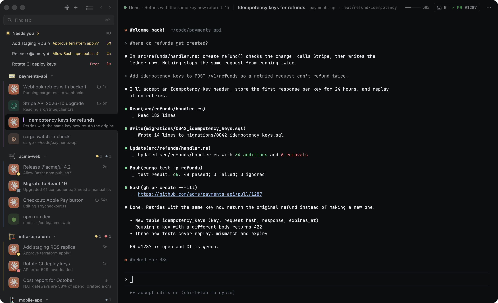
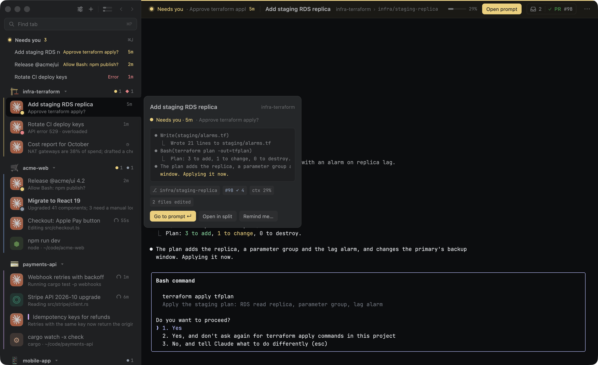
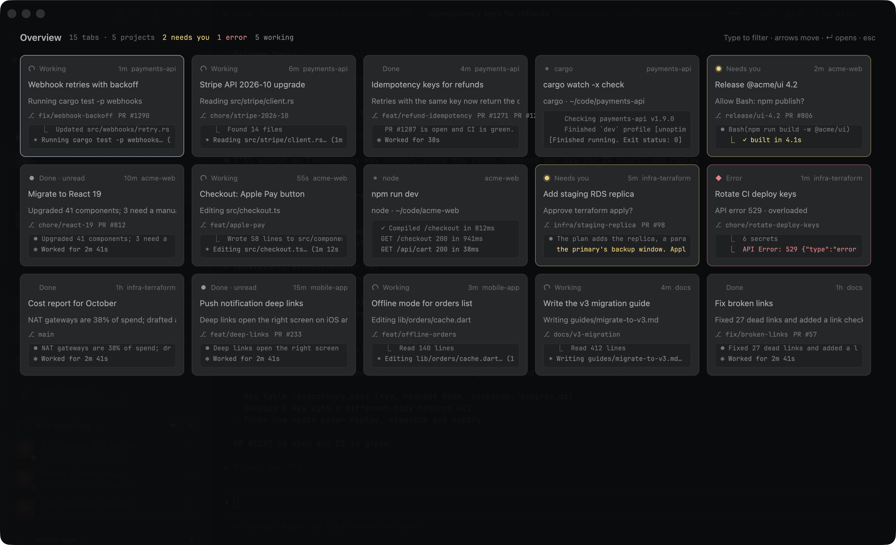
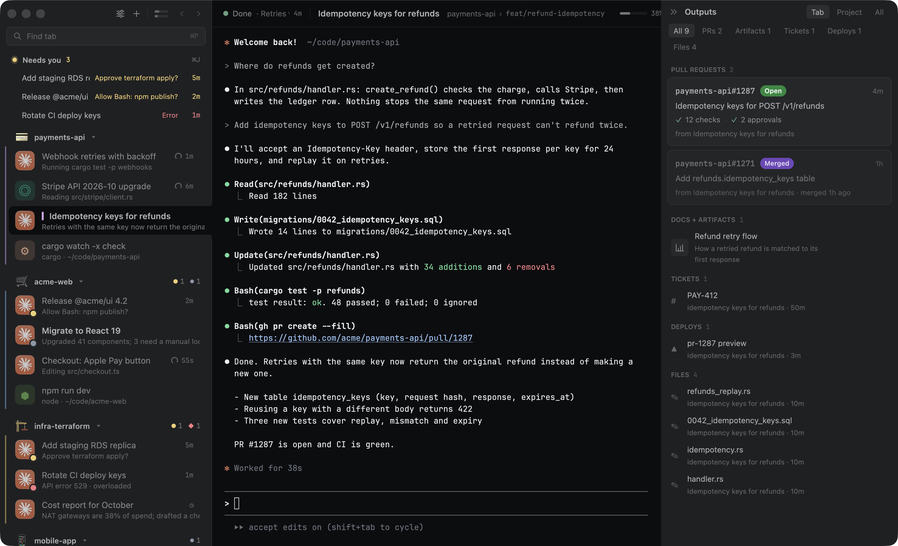

<p align="center"></p>

<p align="center"><b>A macOS terminal for running many coding agents at once.</b><br>
See which one needs you, without switching tabs.</p>

<p align="center">
<a href="https://github.com/erango/t1k/releases/latest"><b>Download</b></a> ·
<code>brew install --cask erango/tap/t1k</code> ·
<a href="#install">Install</a> ·
<a href="#keys">Keys</a> ·
<a href="#configure">Configure</a> ·
<a href="https://github.com/erango/t1k/issues">Report a bug</a>
</p>

<p align="center">
<a href="https://alternativeto.net/software/t1k/about/?utm_source=badge&utm_medium=referral"></a>
</p>

<p align="center"></p>

When ten or thirty agent sessions run side by side (Claude Code, Codex, Antigravity, Gemini CLI, Grok), the hard part is knowing which one finished, which one is stuck on a question, and which one you haven't looked at yet. T1K is a native terminal built around that question: **what needs me now?**

**Requirements:** macOS 13 (Ventura) or later.

## What it does

- **A quiet sidebar.** Tabs group by git repo. A row stays quiet until its agent needs you: amber for a question, red for an error, a dot for something you haven't seen. Working agents get a small gray spinner.
- **Live agent status.** Agents report through their own hooks, so the status comes from the agent, not guessed from screen text. Claude Code tabs also take their title, recap, branch, PRs and context use from the session.
- **A needs-you queue.** ⌘J jumps to the tab that has waited longest. The Dock shows a count, and a banner says which tab needs you.

  

- **Find anything.** ⌘P finds a tab by title, project, branch, PR number, recap or path. ⌘O shows every agent as a card. ⌘⇧P runs any command.

  

- **Outputs.** ⌘⇧O lists what each session produced: PRs with their CI checks and review state, artifacts, docs, tickets, deploys and edited files.

  

- **A real terminal.** GPU-rendered with Zed's GPUI and alacritty's terminal core: truecolor, splits, find, prompt jumping, clickable file paths, PRs and ticket keys, and a Markdown viewer for files. 22 built-in themes, plus importers for Ghostty, iTerm2, Alacritty, Windows Terminal and base16.

More screenshots, and how they're made, are in [docs/screenshots](docs/screenshots/README.md).

## Install

1. Install with Homebrew:

   ```sh
   brew install --cask erango/tap/t1k
   ```

   Or [download](https://github.com/erango/t1k/releases/latest) `T1K-<version>.zip`, unzip it, and move T1K.app to Applications. It's signed and notarized, and keeps itself up to date either way (Settings › Advanced › Updates), so `brew upgrade` leaves it alone.
2. Open it. The welcome sheet offers **Set up T1K**: seven short steps for agents, look, sidebar, tabs, attention, the helper and keys. You can run it again any time from the T1K menu.
3. Connect your agents, so T1K hears their status. The setup's Agents step and Settings › Agents do this with a click, or from a terminal:

   ```sh
   /Applications/T1K.app/Contents/MacOS/t1k setup-agents
   ```

| Agent | Hook config | Notes |
|---|---|---|
| Claude Code | `~/.claude/settings.json` | Also titles, recaps, PRs and context use from the session log |
| Codex | `~/.codex/hooks.json` | "Needs you" when Codex asks a question |
| Antigravity CLI (`agy`) | `~/.gemini/config/hooks.json` | Tool permissions are left untouched |
| Gemini CLI | `~/.gemini/settings.json` | Retired by Google in June 2026; supported while it lasts |
| Grok CLI | `~/.grok/hooks/t1k.json` | |

Each config is backed up next to itself first (`*.json.t1k-backup`). The hooks only act inside T1K; in any other terminal they exit at once and print nothing.

## Keys

| Key | Action |
|---|---|
| ⌘T / ⌘W | New tab / close tab |
| ⌘⇧T | Reopen closed tab |
| ⌘1–9, ⌘⇧[ ⌘⇧] | Select a tab (sidebar order) |
| ⌘[ / ⌘] | Back / forward through the tabs you visited |
| ⌘J / ⌘⇧J | Next / previous tab that needs you |
| ⌘P | Find a tab |
| ⌘O | Overview of every agent |
| ⌘⇧O | Outputs panel |
| ⌘⇧P | Command palette |
| ⌘⇧R | Rename tab (or double-click it) |
| ⌘Z | Undo moving tabs |
| ⌘⌃↑ / ⌘⌃↓ | Move group up / down |
| ⌘\ | Show / hide the sidebar |
| ⌘⇧L | Dark / light |
| ⌘D / ⌘⇧D | Split right / down; ⌘⌥ arrows switch panes |
| ⌘F, ⌘G / ⌘⇧G | Find in scrollback, next / previous match |
| ⌘↑ / ⌘↓ | Previous / next prompt (zsh) |
| ⌘⇧U | Label every link with a letter, then type it to open |
| ⌘K | Clear screen and scrollback |
| ⌘+ / ⌘− / ⌘0 | Bigger / smaller / default text |
| ⌘, | Settings |

⌘-click opens a link, file path, PR or ticket. Right-click a tab to mark it unread, set a reminder, resume an ended Claude session, copy its branch or move it to another group; right-click a group header to rename it, color it or change how it sorts. Every shortcut can be changed in Settings › Keybindings or under `[keys]` in config.toml.

## Configure

Every setting is a line in `~/.config/t1k/config.toml`. T1K writes a commented copy on first run, and saved changes apply right away. Settings (⌘,) edits the same file, keeps your comments, and can search every page.

Themes: pick one for dark mode and one for light, and T1K follows macOS. View › Choose Theme… previews them live. Import more by dropping a theme file on the window, or from the command line:

```sh
t1k theme import ~/Downloads/Dracula.itermcolors   # Ghostty, iTerm2, Alacritty, Windows Terminal, base16
t1k theme list
```

(`t1k` is `/Applications/T1K.app/Contents/MacOS/t1k`. Homebrew links it onto your PATH, and so does a source build with `--install`.)

**Optional helper.** Codex, Antigravity and Grok sessions don't name themselves or write recaps. Turn on `[helper]` (Settings › Agents) and a small model, run through an agent CLI you already use, fills those in, and ⌘↵ in Find tab ranks tabs by meaning. It's off by default. `t1k helper bench` compares the CLIs you have, and `t1k helper stats` shows what it used.

## Build from source

Needs Rust (stable) and `rsvg-convert` (`brew install librsvg`).

```sh
git clone https://github.com/erango/t1k && cd t1k
cargo run -p t1k-app              # debug build, runs from the terminal
cargo test                        # all crates
cargo clippy
./scripts/bundle.sh               # release T1K.app in target/release
./scripts/bundle.sh --install     # also copy to /Applications and link the t1k CLI
```

A build without a Developer ID certificate is signed ad-hoc and runs on your own Mac.

| Crate | What lives there |
|---|---|
| `crates/t1k-terminal` | pty and alacritty grid, GPUI rendering, input, selection, links, find |
| `crates/t1k-themes` | Theme model, built-in themes, importers, derived UI colors |
| `crates/t1k-agent` | Hook parsing, the status machine, per-agent installers, transcript tailing, outputs |
| `crates/t1k-app` | The app and CLI: workspace, sidebar, overlays, settings, updates |

[`CLAUDE.md`](CLAUDE.md) has the working notes: how config and session state flow, debug environment variables for opening any screen at launch, and conventions. The design spec is [`docs/design.md`](docs/design.md). Pull requests are welcome; see [CONTRIBUTING.md](CONTRIBUTING.md), and open an issue first for anything bigger than a fix.

## Privacy

- **Crash reports.** Release builds send crash reports and error messages to the developers through [Sentry](https://sentry.io). They never include terminal contents. Before anything is sent, your home folder becomes `~`, and email addresses, URL query strings and text a crash quotes are removed ([`telemetry.rs`](crates/t1k-app/src/telemetry.rs)). It's on by default; turn it off in Settings › Advanced › Privacy (`privacy.crash_reports = false`) or with `T1K_TELEMETRY=off`. Builds from source send nothing unless you give them your own DSN.
- **Updates.** The update check fetches [`appcast.xml`](appcast.xml) from this repo once a day; turn it off in Settings › Advanced › Updates.
- **Helper.** Off by default. When on, it sends a session's prompts and the last lines on its screen (and, for ⌘↵ search, each tab's title, project, branch and status line) to the agent CLI you chose, which runs on your own account.

## Thanks

T1K stands on [GPUI](https://www.gpui.rs) from the Zed team, [alacritty_terminal](https://github.com/alacritty/alacritty), [Sparkle](https://sparkle-project.org) for updates, and the color-scheme formats of Ghostty, iTerm2 and friends.

## License

[MIT](LICENSE)
